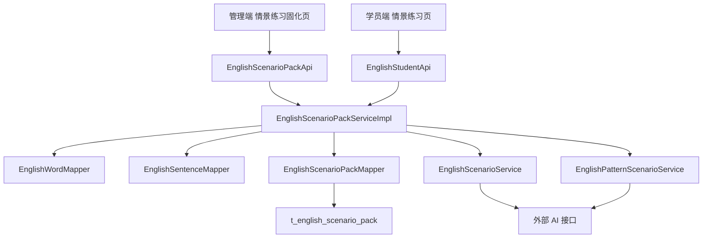

# 英语单元情景练习预生成固化 技术设计

Feature Name: 2026-10-13-english-scenario-pack
Updated: 2026-10-13

## Description

将学员端「情景对话练习」「重点句式情景」由“进入即实时调用大模型”改为“管理端预生成 + 固化落库 + 学员端只读固化内容”。

核心流程：
1. 管理端按 `版本+年级+册别+单元` 选择目标，分别对单元单词集与句式集自动分组，逐组调用 AI 生成情景（预览，不落库）。
2. 人工预览确认后，以 `版本+年级+册别+单元` 为业务键覆盖保存为一条情景内容包。
3. 学员端读取该内容包，按组顺序合并展示，全程不触发实时 AI。

设计沿用既有「AI 单元内容包」（`t_english_ai_pack` / `EnglishAiPackServiceImpl` / `EnglishAiPackApi` / `WordAiManagePage.jsx`）的“生成-预览-保存”范式，以降低认知与实现成本。

## Architecture



要点：
- `EnglishScenarioPackServiceImpl`（rdbms）负责分组、编排与固化；AI 调用委托给既有两个情景服务。
- 学员端与管理端共用 `EnglishScenarioPackService`，但走不同只读/读写方法。
- 学员端接口响应结构与现状保持一致（`List<EnglishScenarioView>` / `List<EnglishPatternScenarioView>`），前端仅需调整空态与“换一组”语义。

## Components and Interfaces

### 新增

1. 实体 `EnglishScenarioPack`（rdbms `domain/model`，继承 `BaseModel`，`@TableName("t_english_scenario_pack")`）
   - 字段：`version, grade, term, unit, wordContent, wordCount, patternContent, patternCount`
2. Mapper `EnglishScenarioPackMapper`（`extends BaseMapper<EnglishScenarioPack>`）
3. 服务接口 `EnglishScenarioPackService`（shared `service`）
   - `EnglishScenarioPackView generate(String version, String grade, String term, String unit)`：分组生成预览，不落库
   - `EnglishScenarioPackView savePack(EnglishScenarioPackView view)`：按业务键覆盖保存
   - `PaginationResponse<EnglishScenarioPackView> listPacks(EnglishScenarioPackQuery query)`
   - `EnglishScenarioPackView getPack(String id)`
   - `void deletePack(String id)`
   - `List<String> listUnits(String version, String grade, String term)`：该册存在单词或句式的单元
   - `List<EnglishScenarioView> getWordScenarios(String version, String grade, String term, String unit)`：合并返回单词情景
   - `List<EnglishPatternScenarioView> getPatternScenarios(String version, String grade, String term, String unit)`：合并返回句式情景
4. 服务实现 `EnglishScenarioPackServiceImpl`（rdbms）
5. 接口 `EnglishScenarioPackApi`（api，`@RequestMapping("${api.prefix}/english/scenario-pack")`，权限 `english:word:ai`）
6. 视图 `EnglishScenarioPackView`、查询 `EnglishScenarioPackQuery`（shared `domain/dto/english`）
7. 分组输入 DTO（shared）：`EnglishScenarioWord{spell, meaning}`、`EnglishPatternSentence{en, zh}`（用于跨模块传递分组子集，避免 shared 依赖 rdbms 实体）
8. 前端页面 `ScenarioPackManagePage.jsx`（`/english/scenario-pack`，复用权限 `english:word:ai`）
9. 前端 API `scenarioPack.js`

### 改造

1. `EnglishScenarioService`（shared）
   - 以 `List<EnglishScenarioView> generateFromWords(String grade, String unit, List<EnglishScenarioWord> words)` 替换原 `generateScenarios(version,grade,term,unit)`
2. `EnglishPatternScenarioService`（shared）
   - 以 `List<EnglishPatternScenarioView> generateFromSentences(String grade, String unit, List<EnglishPatternSentence> sentences)` 替换原 `generateScenarios(version,grade,term,unit)`
3. 两个 `*ScenarioServiceImpl`（rdbms）
   - 移除单元实体加载逻辑（改由内容包服务加载分组），保留 AI 调用、JSON 解析、`normalize*` 规整逻辑；`buildUserPrompt` 改为接收分组 DTO
4. `EnglishStudentApi`
   - 移除对 `EnglishScenarioService` / `EnglishPatternScenarioService` 的直接依赖，改注入 `EnglishScenarioPackService`
   - `/scenarios` → `getWordScenarios(...)`；`/pattern-scenarios` → `getPatternScenarios(...)`
5. 前端 `EnglishScenarioPracticePage.jsx` / `EnglishPatternScenarioPage.jsx`
   - 加载/空态文案调整；移除“换一组”（改为“重做本组”）
   - “换一组”按钮语义由“重新生成”改为不存在，避免误导
6. 前端 `MainLayout.jsx` / `App.jsx`
   - 英语板块新增菜单「情景练习固化」→ `/english/scenario-pack`；新增路由（`AuthGuard required=['english:word:ai']`）
7. 种子脚本 `init-h2.sql` / `init-mysql.sql`
   - 新增 `t_english_scenario_pack` 建表 + 幂等 `ALTER`

## Data Models

### 表 t_english_scenario_pack

| 列 | 类型 | 说明 |
|----|------|------|
| id | varchar(64) | 主键 |
| version | varchar(32) | 教材版本 |
| grade | varchar(16) | 年级 |
| term | varchar(16) | 学期（上册/下册） |
| unit | varchar(32) | 单元 |
| word_content | text | 单词情景分组 JSON |
| word_count | int | 单词情景场景总数 |
| pattern_content | text | 句式情景分组 JSON |
| pattern_count | int | 句式情景情景总数 |
| create_at / create_by / update_at / update_by / is_deleted | 审计列 | 与 `BaseModel` 对应 |

H2 建表（幂等）：

```sql
CREATE TABLE IF NOT EXISTS t_english_scenario_pack (
  id varchar(64) NOT NULL,
  version varchar(32) COMMENT '教材版本',
  grade varchar(16) COMMENT '年级',
  term varchar(16) COMMENT '学期（上册/下册）',
  unit varchar(32) COMMENT '单元',
  word_content text COMMENT '单词情景分组 JSON',
  word_count int DEFAULT 0 COMMENT '单词情景场景总数',
  pattern_content text COMMENT '句式情景分组 JSON',
  pattern_count int DEFAULT 0 COMMENT '句式情景情景总数',
  create_at timestamp DEFAULT CURRENT_TIMESTAMP,
  create_by varchar(256),
  update_at timestamp,
  update_by varchar(256),
  is_deleted tinyint DEFAULT 0,
  PRIMARY KEY (id)
);
```

MySQL 版本同步新增（反引号、`ADD COLUMN IF NOT EXISTS`）。

### word_content JSON 结构

```json
{
  "groups": [
    {
      "groupNo": 1,
      "words": ["apple", "banana"],
      "scenarios": [ { "title": "...", "words": ["apple"], "lines": [ { "speaker": "A", "en": "I like ___.", "zh": "我喜欢苹果。", "answers": ["apple"] } ] } ]
    }
  ]
}
```

### pattern_content JSON 结构

```json
{
  "groups": [
    {
      "groupNo": 1,
      "sentences": ["What's this?"],
      "scenarios": [ { "title": "...", "context": "...", "patterns": ["What's this?"], "turns": [ { "speaker": "A", "en": "...", "zh": "...", "options": ["...", "..."], "answerIndex": 0, "explanation": "..." } ] } ]
    }
  ]
}
```

### 分组常量

- `WORD_GROUP_SIZE = 8`：单词情景分组大小。
- `PATTERN_GROUP_SIZE = 6`：句式情景分组大小。
- 每组场景数沿用既有规则：`size >= 9 ? 4 : 3`（分组上限小于阈值时恒为 3，保证每组单次调用输出可控）。

## Application Programming Interfaces

### 管理端（`/api/english/scenario-pack`，权限 `english:word:ai`）

- `POST /generate?version=&grade=&term=&unit=`：生成预览（不落库），返回 `EnglishScenarioPackView`
- `POST /save`：body `EnglishScenarioPackView`，覆盖保存
- `GET /list?version=&grade=&term=&unit=&current=&pageSize=`：分页列表（不含正文），返回 `PaginationResponse<EnglishScenarioPackView>`
- `GET /detail?id=`：详情（含正文）
- `POST /delete?id=`：逻辑删除
- `GET /units?version=&grade=&term=`：该册单元列表（用于批量）

### 学员端（沿用现路径，改读固化）

- `GET /api/english/student/scenarios`：返回合并后的 `List<EnglishScenarioView>`
- `GET /api/english/student/pattern-scenarios`：返回合并后的 `List<EnglishPatternScenarioView>`

### 批量生成

不新增后端批量接口：由前端管理页对 `/units` 返回的单元顺序调用 `POST /generate` 与 `POST /save`，逐个展示进度与结果，单单元失败不影响后续。

## Correctness Properties

1. 业务键唯一：`版本+年级+册别+单元` 在有效记录中最多一条；重复保存为覆盖更新。
2. 合并一致：学员端返回单词情景数等于内容包 `wordCount`，句式情景数等于 `patternCount`。
3. 覆盖子集：任意情景的 `words` 是所属组 `words` 的子集；任意句式情景的 `patterns` 是所属组 `sentences` 的子集。
4. 空位对齐：单词情景每行 `en` 的 `___` 数量与 `answers` 长度一致（沿用 `normalizeScenarios`）。
5. 分组不丢词：单元单词集合的每个词至少出现在一个单词情景组的 `words` 中（分组为按顺序切分，覆盖全部输入）。
6. 学员端只读：学员端情景接口不触发任何外部 AI 调用。

## Error Handling

| 场景 | 处理 |
|------|------|
| AI 未启用 | `ValidationException("AI 服务未启用...")`，管理端预览页展示提示 |
| Token 未配置 | `ValidationException("AI Token 未配置...")` |
| AI 返回空/JSON 异常 | `ValidationException("AI 返回内容为空/格式异常")`，管理端可重试 |
| 保存缺少内容 | `ValidationException("请先生成内容再保存")` |
| 学员端无固化内容 | 返回空列表，前端展示「该单元练习尚未生成，请联系老师」 |
| 批量某单元失败 | 记录失败信息，前端逐单元展示，继续后续单元 |
| 前端生成请求超时 | 生成/保存类请求按调用点覆盖 axios `timeout`（如 300000ms），规避默认 30s |

## Test Strategy

1. 单元测试
   - 分组切分：单词按 8、句式按 6，输入不足一组时单组，超出时多组，全部词被覆盖。
   - JSON 合并：`getWordScenarios` / `getPatternScenarios` 按 `groupNo` 顺序展平，数量正确。
   - 幂等保存：同业务键两次保存后仅一条有效记录。
2. 集成测试（本地 H2 + 已配置 AI）
   - 管理端 `generate → save → list → detail → delete` 全链路。
   - 学员端 `scenarios` / `pattern-scenarios` 返回固化内容且与 `wordCount/patternCount` 一致。
3. 前端手测
   - 管理端生成单单元、批量整册、预览、保存、删除。
   - 学员端进入已固化单元秒开；未固化单元展示提示且无“换一组”。

## References

- [EnglishScenarioServiceImpl.java L71](../../../server/rdbms/src/main/java/cn/wisestar/server/impl/EnglishScenarioServiceImpl.java)
- [EnglishPatternScenarioServiceImpl.java L74](../../../server/rdbms/src/main/java/cn/wisestar/server/impl/EnglishPatternScenarioServiceImpl.java)
- [EnglishAiPackServiceImpl.java L124](../../../server/rdbms/src/main/java/cn/wisestar/server/impl/EnglishAiPackServiceImpl.java)
- [EnglishAiPackApi.java](../../../server/api/src/main/java/cn/wisestar/server/api/EnglishAiPackApi.java)
- [EnglishStudentApi.java L118](../../../server/api/src/main/java/cn/wisestar/server/api/EnglishStudentApi.java)
- [init-h2.sql L2367](../../../server/rdbms/src/main/resources/scripts/init-h2.sql)
- [WordAiManagePage.jsx](../../../wisestar-client/src/pages/english/WordAiManagePage.jsx)
