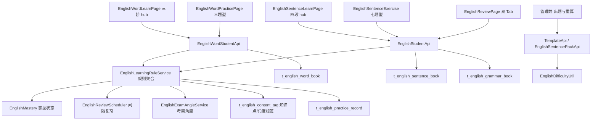
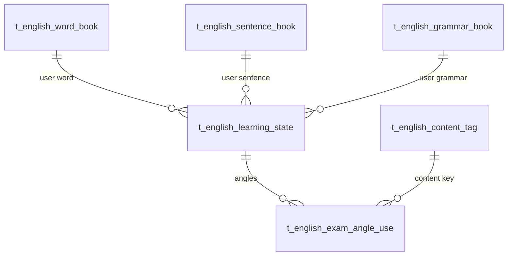

# 英语学习系统升级 技术设计

Feature Name: 2026-11-05-english-learning-upgrade
Updated: 2026-11-05
基于：`requirements.md`、`英语学习系统升级需求文档 V2.0`、`AI 英语出题任务规范（外研版 3-9 年级）`

## Description

本次升级在既有英语模块上做四类改造，不重建模块：

1. **链路改造**：单词页由「单词学习 / 单词练习 / 场景对话」三个平级按钮，改为小节内「记忆 → 练习 → 运用」三阶；句式页由「句子学习 / 句式情景 / 句子练习」三卡，改为「课本跟读 → 句子学习 → 句子练习 → 情景对话」四段。
2. **题型补齐**：新增「听英文选中文」「词汇默写」「句式词汇填空」「句子默写」四个题型。前两者作用于单词，后两者作用于句式。听英文选中文与词汇默写在前端即时生成，句式词汇填空与句子默写复用现有 `EnglishSentenceExercise` 的 `fill` / `dictation` 实现并接入新入口。
3. **规则沉降**：把「复习按知识点出派生题」「薄弱点按知识点聚合 + 输出题权重更高 + 连续 2 道不同角度答对才攻克」「通关标准按小节/单元分阶段判定」写成后端可判定的规则服务，前端只负责展示状态。
4. **难度治理**：新增年级难度上限过滤与两个重算接口，保证低年级主线学习不出现 hard 题。

不新建整套题型体系，不引入实时 AI 出题。所有派生题由后端批量预生成或按知识点模板即时派生，学员端运行时不调用大模型。

## Architecture

要点：
- 规则判定集中在 `EnglishLearningRuleService`（rdbms 层），学员端 API 只做参数校验与拼装，避免前端各页自行计算同一条规则。
- 掌握状态、复习到期、考察角度三者分离：掌握状态回答「这个词到什么程度」，复习调度回答「什么时候该复习」，考察角度回答「这次复习用哪种考法」。三个维度不能互相覆盖。
- 词汇与句式共用 `EnglishReviewScheduler`，不新增第二套间隔算法。

## Components and Interfaces

### 新增

1. `EnglishLearningRuleService`（shared 接口 + rdbms 实现）
   - `SectionProgressView sectionProgress(String userId, String unit)`：按小节返回三阶完成数与通关状态。
   - `List<AngleCandidateView> reviewCandidates(String userId, String unit, String module)`：返回该单元待复习知识点与可用考察角度。
   - `WeakPointJudgeView judgeWeak(String knowledgeId, String module)`：按聚合统计给出三态与是否薄弱。
   - `boolean markBreakthrough(String userId, String knowledgeId, String module, String angle, boolean outputType)`：累计连续正确与输出题达标，返回是否攻克。
   - `UnitPassView unitPass(String userId, String unit, String module)`：单元/小节通关判定与各阶段正确率。
2. `EnglishExamAngleService`（rdbms）
   - `List<String> anglesOf(String module)`：各模块允许的考察角度集合。
   - `String nextAngle(String knowledgeId, String module, List<String> usedAngles)`：在未使用角度中挑选下一个。
   - `boolean isSameAngle(String a, String b)`：防「换汤不换药」比对入口。
3. 表 `t_english_learning_state`（知识点学习状态与攻克计数）
   - 业务键 `user_id + module + knowledge_id`。
   - 字段：`state`（familiar/ordinary/unfamiliar）、`consecutive_correct`、`last_angle`、`output_correct_count`、`weak_flag`、`weak_reason`、`update_at`。
4. 表 `t_english_exam_angle_use`（考察角度使用记录，防重复角度）
   - 业务键 `user_id + module + knowledge_id + angle`。
   - 字段：`use_count`、`last_use_at`。
5. 视图：`SectionProgressView`、`AngleCandidateView`、`WeakPointJudgeView`、`UnitPassView`（shared `domain/dto/english`）。

### 修改

1. `EnglishWordView` 增加 `masteryState`（familiar/ordinary/unfamiliar）与 `angleUsed`（已用角度列表），供前端圆环与复习入口使用。
2. `EnglishUnitProgressView` 增加 `wordPassRate`、`sentencePassRate`、`reviewDueWord`、`reviewDueSentence`，把「单元通关百分比」拆成单词与句式两条线。
3. `EnglishStudentServiceImpl.unitProgress` 改为调用 `EnglishLearningRuleService`，不再在服务内散落阈值常量。
4. `EnglishWordServiceImpl.recordLearning` 在写入单词本之后调用 `EnglishLearningRuleService` 更新学习状态与攻克计数；`source` 增加 `word-use`（单词运用）以便区分输出题型。
5. `EnglishSentenceExercise` 的 `fill` / `dictation` 由「mix 模式下的固化题」扩展为可独立入口，`mode` 增加 `fill`、`dictation` 两种，走即时生成分支。
6. `EnglishDifficultyUtil` 增加 `Result#exceedsGradeLimit(String grade)`，把年级上限判断从调用方收敛到工具内。
7. `EnglishWordPracticePage` 题型池增加 `listen`（听英文选中文）：播放音频、仅给中文选项，前端 `englishQuiz.js` 增 `QUIZ_TYPE.LISTEN`。

### 不新增

- 不新增复习调度算法：继续使用 `EnglishReviewScheduler` 的艾宾浩斯间隔。
- 不新增 AI 出题接口：派生题由 `EnglishFusionQuestionFactory` 与内容包预生成承担。
- 不把全局错题本迁入复习池：两类数据继续分表、分 Tab。

## Data Models

`t_english_learning_state` 与三个 `*_book` 表并存：`*_book` 保存熟练度与复习时间（既有口径不变），`learning_state` 保存三态、攻克计数与角度使用情况（新口径）。两表以 `user_id + module + knowledge_id` 关联，不合并表结构，避免迁移既有数据。

三态映射：
- `unfamiliar`：无答题记录，或累计正确率 < 60%，或存在连续 2 道错。
- `ordinary`：累计正确率 60%~85%，或正确率达标但输出题型未通过。
- `familiar`：满足模块通关正确率阈值且输出题型至少 1 次正确。

攻克判定（与 R6 一致）：
- 连续 2 道不同角度派生题正确；
- 若知识点存在输出题型错题，需至少 1 道输出题型在复习中答对；
- 任一条件被打破则 `consecutive_correct` 清零。

## Correctness Properties

1. **状态与通关解耦**：掌握三态变化不得直接改写 `familiarity`，反之亦然；两套字段各自单调变化，不互相覆盖。
2. **角度不重复**：同一知识点连续两次复习不得使用同一 `exam_angle`，除非该知识点可用角度已耗尽。
3. **复习不跨单元**：`reviewCandidates(unit)` 返回的 `knowledge_id` 必须全部属于该单元的词/句/语法集合。
4. **错题本恒定**：模块内复习仅影响 `learning_state` 与角度记录，不得写 `t_english_wrong_question.eliminated`。
5. **难度单调**：年级上限过滤只会减少可用题集，不会提升任何题目的计算难度。
6. **通关阈值唯一**：所有正确率阈值定义在 `EnglishMastery` 与 `EnglishLearningRuleService` 常量，前端不得硬编码数字。

## Error Handling

- 知识点不存在或不属于该单元时，`reviewCandidates` 返回空集并在日志记录 `knowledgeId`，不抛业务异常。
- 干扰项不足（单元内可选项 < 4）时，前端 `buildQuestion` 返回 `null` 并跳过该题；后端 `unitPass` 仍按实际题数计分。
- 难度过滤把某知识点下所有候选题过滤光时，回落到母题难度档中最低的一档，并标记 `fallback=true` 供管理端排查。
- 学习状态表写入失败不得阻断答题主流程：`recordLearning` 采用 try-catch 记录日志，主流程照常返回。
- 重算接口在历史题目缺少标签时跳过该题并累计 `skipped` 计数，返回结果含 `updated / skipped / failed`。

## Test Strategy

- 单元测试：
  - `EnglishLearningRuleServiceTest`：三态映射边界（59%/60%/85%）、连续 2 题攻克、第 3 题答错清零、输出题型单独要求。
  - `EnglishDifficultyUtilTest` 增补：`exceedsGradeLimit` 对 1~2 / 3~4 / 5~6 年级的三张上限表。
  - `EnglishExamAngleServiceTest`：角度不重复与角度耗尽回落。
- 接口测试：
  - `unitPass` 对同一小节在「只做记忆」「记忆+练习」「三阶全做」三种数据下的通关结果。
  - `reviewCandidates` 单元隔离：Unit 1 的复习候选不得含 Welcome 的知识点。
- 前端：
  - `englishQuiz` 单测补 `LISTEN` 题型生成与干扰项不足跳过。
  - `EnglishSentenceExercise` 的 `fill` / `dictation` 独立入口渲染与判分。
- 手工回归：
  - 低年级（三年级）单词页不出现 hard 题；六年级允许三档。
  - 复习页两个 Tab 数据互不污染，错题本「消灭错题」后复习池数量不变。

## 实施顺序建议

1. 数据表与常量（`t_english_learning_state`、`t_english_exam_angle_use`、阈值常量）。
2. 规则服务与难度过滤（后端可单测）。
3. 学员端 API 改造（unitProgress / recordLearning / reviewCandidates）。
4. 单词三阶与句式四段前端重构。
5. 新增四个题型的前端实现。
6. 复习页双 Tab 与角标。
7. 重算接口与管理端入口。
8. 文档与快照。

## References

- 需求来源：`英语学习系统升级需求文档 V2.0（评审稿）`
- 出题规范：`AI 英语出题任务规范（外研版 3-9 年级）`
- 难度工具：`server/rdbms/src/main/java/cn/wisestar/server/core/uitls/EnglishDifficultyUtil.java`
- 掌握度：`server/rdbms/src/main/java/cn/wisestar/server/impl/EnglishMastery.java`
- 复习调度：`server/rdbms/src/main/java/cn/wisestar/server/impl/EnglishReviewScheduler.java`
- 难度文档：`docs/英语难度分级标准.md`
