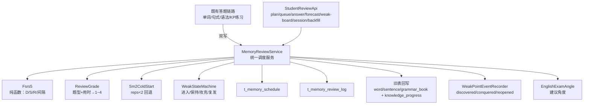

# 知识点弱点攻克系统重构（记忆调度引擎）技术设计

Feature Name: 2026-11-16-weakness-forgetting-engine
Updated: 2026-11-16
基于：`requirements.md`、现有 WPB 实现（`EvaluationServiceImpl` / `WeakPointEvent`）、英语学习升级（`EnglishLearningRuleServiceImpl` / `EnglishExamAngle`）、新题型与考察角度

## Description

本次重构新增一层「记忆调度引擎」，接管两件事：**下次复习时间**与**薄弱严重度**。旧有的「最近 5 次正确率加权」与「固定艾宾浩斯档位」保留为兼容派生量，不再作为调度与薄弱排序的依据。

不重建页面、不改既有接口返回结构；新增独立表、独立服务与独立 Controller，并在既有答题链路上做双写。这样旧页面（单词本、复习候选、通关、错题本、薄弱列表）在不改前端的前提下继续工作，同时新接口可以给出更准确的计划、预测与看板。

主模型选 FSRS-5：难度 D、稳定度 S、可提取度 R 三元组，默认目标保持率 0.9。历史不足 2 次时用 SM-2 冷启动。Leitner 仅用于把稳定度映射成界面上的 0~4 熟练度，不参与调度。

## Architecture



分层与依赖方向不变：`api → rdbms → shared`。`shared` 放服务接口、请求/视图 DTO 与常量；`rdbms` 放实体、Mapper、纯函数与实现；`api` 只做参数校验与编排。

## Components and Interfaces

### shared

1. `cn.wisestar.server.service.MemoryReviewService`
   - `ReviewAnswerResult recordAnswer(String userId, ReviewAnswerCommand command)`：单次作答入账，返回评分、稳定度、下次到期、薄弱与攻克结果。
   - `ReviewAnswerResult recordKpPractice(String userId, String subjectId, String kpId, int correctRate, int total)`：知识点级会话入账（会话正确率折算评分）。
   - `ReviewPlanView plan(String userId, String subjectId)`：今日计划。
   - `List<ReviewQueueItemView> queue(String userId, ReviewQueueRequest request)`：复习队列。
   - `ReviewForecastView forecast(String userId, String subjectId, int days)`：到期预测与平均可提取度。
   - `List<WeakBoardItemView> weakBoard(String userId, String subjectId, int limit)`：薄弱看板。
   - `List<ReviewQueueItemView> weakSession(String userId, WeakSessionRequest request)`：攻克训练。
   - `int backfill(String userId)`：幂等回填，返回新增条数。
2. DTO（`domain/dto/review`）：`ReviewAnswerCommand`、`ReviewAnswerResult`、`ReviewPlanView`、`ReviewQueueRequest`、`ReviewQueueItemView`、`ReviewForecastView`、`WeakBoardItemView`、`WeakSessionRequest`。
3. 常量 `ReviewModule`：`word` / `sentence` / `grammar` / `kp`。
4. 常量 `ReviewDemand`：`recognition` / `cued` / `application` / `full`，并带 `weightOf`、`easyRatio`、`hardRatio`、`medianMillis`。

### rdbms

1. `impl.fsrs.Fsrs5`（纯函数）
   - `double initDifficulty(int grade)`、`double initStability(int grade)`
   - `double retrievability(double elapsedDays, double stability)`
   - `double nextInterval(double stability, double retention)`
   - `double nextDifficulty(double difficulty, int grade)`
   - `double nextStability(double difficulty, double stability, double retrievability, int grade, double demandFactor)`
   - `double nextShortTermStability(double stability, int grade)`
2. `impl.fsrs.Sm2ColdStart`
   - `Sm2State next(int repetitions, double easeFactor, int grade)`
3. `impl.fsrs.ReviewGrade`
   - `int gradeOf(boolean correct, Long latencyMs, boolean hintUsed, boolean retried, String demand)`
4. `impl.WeakStateMachine`
   - `WeakTransition evaluate(WeakSnapshot before, WeakEvidence evidence)`
5. `impl.MemoryReviewServiceImpl`：编排事务、读写两张新表、回写旧表、发事件。
6. 实体 `MemorySchedule`、`MemoryReviewLog`；Mapper 同名。
7. `impl.EnglishReviewScheduler` 标记 `@Deprecated`：仅作为旧数据兜底，不再被新链路调用。

### api

`StudentReviewApi`（`${api.prefix}/student/review`、`/student/weak`）：

| 方法 | 路径 | 入参 | 返回 |
| --- | --- | --- | --- |
| GET | `/review/plan` | `subjectId?` | `ReviewPlanView` |
| POST | `/review/queue` | `ReviewQueueRequest` | `List<ReviewQueueItemView>` |
| POST | `/review/answer` | `ReviewAnswerCommand` | `ReviewAnswerResult` |
| GET | `/review/forecast` | `subjectId?`、`days=30` | `ReviewForecastView` |
| GET | `/weak/board` | `subjectId?`、`limit=50` | `List<WeakBoardItemView>` |
| POST | `/weak/session` | `WeakSessionRequest` | `List<ReviewQueueItemView>` |
| POST | `/review/backfill` | 无 | `int`（新增条数） |

全部 `@PreAuthorize("isAuthenticated()")`，服务层固定当前登录用户，不接受外部传入 `userId`。

## Data Models

```sql
CREATE TABLE IF NOT EXISTS t_memory_schedule (
  id varchar(64) NOT NULL,
  user_id varchar(64) NOT NULL,
  module varchar(32) NOT NULL,
  subject_id varchar(64),
  knowledge_id varchar(191) NOT NULL,
  state varchar(16) DEFAULT 'new',
  difficulty double DEFAULT 5,
  stability double DEFAULT 0,
  reps int DEFAULT 0,
  lapses int DEFAULT 0,
  last_grade int DEFAULT 0,
  last_angle varchar(32),
  last_demand varchar(16),
  last_review_at timestamp,
  due_at timestamp,
  scheduled_days double DEFAULT 0,
  elapsed_days double DEFAULT 0,
  output_wrong int DEFAULT 0,
  weak_flag tinyint DEFAULT 0,
  weak_reason varchar(32),
  first_weak_at timestamp,
  conquered_at timestamp,
  reclaim_count int DEFAULT 0,
  create_at timestamp DEFAULT CURRENT_TIMESTAMP,
  create_by varchar(256),
  update_at timestamp,
  update_by varchar(256),
  is_deleted tinyint DEFAULT 0,
  PRIMARY KEY (id),
  UNIQUE KEY uk_memory_user_module_kp (user_id, module, knowledge_id)
);
CREATE INDEX IF NOT EXISTS idx_memory_due ON t_memory_schedule (user_id, due_at);
CREATE INDEX IF NOT EXISTS idx_memory_weak ON t_memory_schedule (user_id, weak_flag, due_at);

CREATE TABLE IF NOT EXISTS t_memory_review_log (
  id varchar(64) NOT NULL,
  user_id varchar(64) NOT NULL,
  module varchar(32) NOT NULL,
  subject_id varchar(64),
  knowledge_id varchar(191) NOT NULL,
  grade int NOT NULL,
  correct tinyint DEFAULT 0,
  latency_ms int,
  angle varchar(32),
  demand varchar(16),
  stability_before double,
  stability_after double,
  difficulty_before double,
  difficulty_after double,
  retrievability_before double,
  elapsed_days double,
  scheduled_days double,
  target_retention double,
  session_id varchar(64),
  reviewed_at timestamp,
  create_at timestamp DEFAULT CURRENT_TIMESTAMP,
  create_by varchar(256),
  update_at timestamp,
  update_by varchar(256),
  is_deleted tinyint DEFAULT 0,
  PRIMARY KEY (id)
);
CREATE INDEX IF NOT EXISTS idx_memory_log_kp ON t_memory_review_log (user_id, module, knowledge_id, reviewed_at);
CREATE INDEX IF NOT EXISTS idx_memory_log_day ON t_memory_review_log (user_id, reviewed_at);
```

两份种子脚本 `init-h2.sql` / `init-mysql.sql` 必须同步。

## Algorithm

### FSRS-5

参数 `w0..w18` 取 FSRS-5 默认值：

```
0.40255, 1.18385, 3.173, 15.69105, 7.1949, 0.5345, 1.4604, 0.0046,
1.54575, 0.1192, 1.01925, 1.9395, 0.11, 0.29605, 2.2698, 0.2315,
2.9898, 0.51655, 0.6621
```

```
R(t,S) = (1 + 19/81 · t/S)^(-0.5)
I(S,r) = S / (19/81) · (r^(-2) - 1)          // 目标保持率 r 对应间隔（天）
D0(G)  = w4 - e^(w5·(G-1)) + 1               // clamp 1..10
S0(G)  = w[G-1]
D'     = w7·D0(4) + (1-w7)·(D - w6·(G-3))    // clamp 1..10
成功: S' = S · (1 + e^w8·(11-D)·S^(-w9)·(e^(w10·(1-R))-1)·w15^[G=2]·w16^[G=4]) · demandGain
失败: S' = min(S, w11·D^(-w12)·((S+1)^w13-1)·e^(w14·(1-R)) · demandPenalty)
同日: S' = S · e^(w17·(G-3+w18)) · demandGain
```

### SM-2 冷启动

`reps < 2` 时：首次成功 1 天、第二次 6 天，之后 `I = I × EF`；失败回到 1 天且 `EF = max(1.3, EF - 0.2)`。`S = I`。`reps ≥ 2` 后转入 FSRS-5，用已有 D/S 继续。

### 评分映射

| 条件 | grade |
| --- | --- |
| 答错 | 1 |
| 答对 + 提示或重做 | 2 |
| 答对 + 用时 < 中位 × 0.55 | 4 |
| 答对 + 用时 > 中位 × 慢速倍数 | 2 |
| 答对 + 其余 | 3 |
| 答对 + 无用时 | 3 |

中位用时：`recognition 6000ms`、`cued 15000ms`、`application 20000ms`、`full 25000ms`。
慢速倍数：`recognition 2.0`、`cued 1.7`、`application 1.75`、`full 1.8`。
`cued/application/full` 成功增益 ×1.08，失败惩罚 ×0.92；严重度 ×1.3。

### 薄弱状态机

进入（满足其一，且证据 ≥2 次或输出错误）：
- `R_now < 0.6`
- 连续答错 ≥ 2
- 输出类答错
- 已攻克后再次答错（`lapse`，同时 `reclaim_count++`）

保持：已在薄弱池时，即使 `R_now ≥ 0.7` 也不自动移出，必须走攻克判定。

攻克（全部满足）：
- 复习前 `R < 0.85`（确属到期复习）
- 本次 `grade ≥ 3`
- 本次角度 ≠ `last_angle`
- 输出薄弱时，本次 `demand ∈ {cued, application, full}` 且 `grade ≥ 3`
- 复习后 `S ≥ 7 天`

移出后写 `conquered_at`、发 `conquered` 事件；后续答错发 `reopened`。

### 严重度

```
severity = (1 - R_now) × demandWeight × (1 + 0.5·lapses) × (outputWeak ? 1.3 : 1) × (weakFlag ? 1.5 : 1)
```

`demandWeight`：`recognition 1.0`、`cued 1.15`、`application 1.25`、`full 1.35`；结果截断到 0~3。
薄弱项加严重度下限 `0.6 + 0.15·min(lapses, 4)`：刚复习完 `R≈1` 时仍能让薄弱项排在队首。

### 掌握度（回写 `UserKnowledgeProgress.mastery`）

```
mastery = 100 × (0.45·R_now + 0.55·accuracy) × confidence × gradeFactor − 4·consecutiveWrong
```

`confidence = min(1, 0.55 + 0.05·answers)`；`gradeFactor`：最近评分 1 → 0.55、2 → 0.8、其余 1.0。刚做错时掌握度会明显下降，不再出现「连错两题仍 80 分」。

### 预计遗忘日期

解得 `R(t)=0.6` 的 t：`t = S/(19/81)·(0.6^(-2)-1) ≈ 1.7778·S` 天，从 `last_review_at` 起算；无复习记录时从当前时间起算。

## Correctness Properties

1. `R(S, S) = 0.9`；`I(S, 0.9) = S`（允许 1e-6 误差）。
2. `R` 随 t 单调递减，随 S 单调递增。
3. 同一 S 下 `grade` 越大，成功后 S 越大；`G=4` 的 S 大于 `G=3`。
4. 难度始终落在 1~10，稳定度始终 ≥ 0.1，失败后 S 不增加。
5. 同日多次作答不会把到期时间排到过去。
6. 薄弱进入/攻克满足状态机转移表；攻克必须同时满足 5 个条件。
7. 同一（用户、模块、知识点）只有一条调度记录，回填幂等。
8. 旧表回写后 `next_review_time` 与调度 `due_at` 一致。

## Error Handling

- 调度计算或落库异常：捕获后 `log.warn`，不阻断答题主流程；旧表写入照常执行。
- 调度记录缺失：按 R7 的映射惰性初始化，随后再计算本次评分。
- 非法入参（模块未知、知识点为空、limit 越界）：抛 `ValidationException`，返回统一错误结构。
- 时钟回拨：`elapsedDays` 截断为 ≥0；到期时间不早于当前时间。
- 并发同一知识点作答：`uk_memory_user_module_kp` 唯一键 + 事务内先查后写；冲突时重查一次再更新。

## Test Strategy

纯函数单测（`rdbms/src/test`）：
- `Fsrs5Test`：R/I 恒等与单调性、D/S 边界、失败不增益、同日公式。
- `Sm2ColdStartTest`：1/6 天序列、EF 下限、失败回退。
- `ReviewGradeTest`：四种作答方式的对错/快慢/提示/重做映射。
- `WeakStateMachineTest`：单次选择错不薄弱、输出错薄弱、攻克五条件、复发。
- `MemoryMapperTest`：回填映射与幂等（mock mapper 或 H2 切片）。

接口自测：`/review/plan`、`/review/queue`、`/review/answer`、`/review/forecast`、`/weak/board`、`/weak/session`、`/review/backfill`，用管理员与学员账号各跑一遍，确认只返回本人数据。

回归：既有 `qa` 无关；确认单词/句式/语法作答后旧表 `next_review_time` 与调度 `due_at` 一致；`mvn clean package -pl api -am -DskipTests` 与 `mvn -pl rdbms test` 通过。

## References

[^1]: (File) - [FSRS-5 默认参数与公式参考（本设计常量）](./requirements.md)
[^2]: (File) - [既有薄弱评价实现](server/rdbms/src/main/java/cn/wisestar/server/impl/EvaluationServiceImpl.java)
[^3]: (File) - [既有复习调度器](server/rdbms/src/main/java/cn/wisestar/server/impl/EnglishReviewScheduler.java)
[^4]: (File) - [考察角度与作答方式](server/rdbms/src/main/java/cn/wisestar/server/impl/EnglishExamAngle.java)
