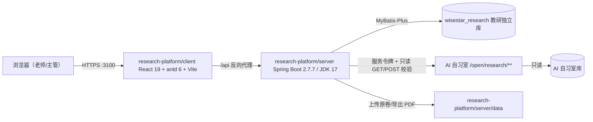
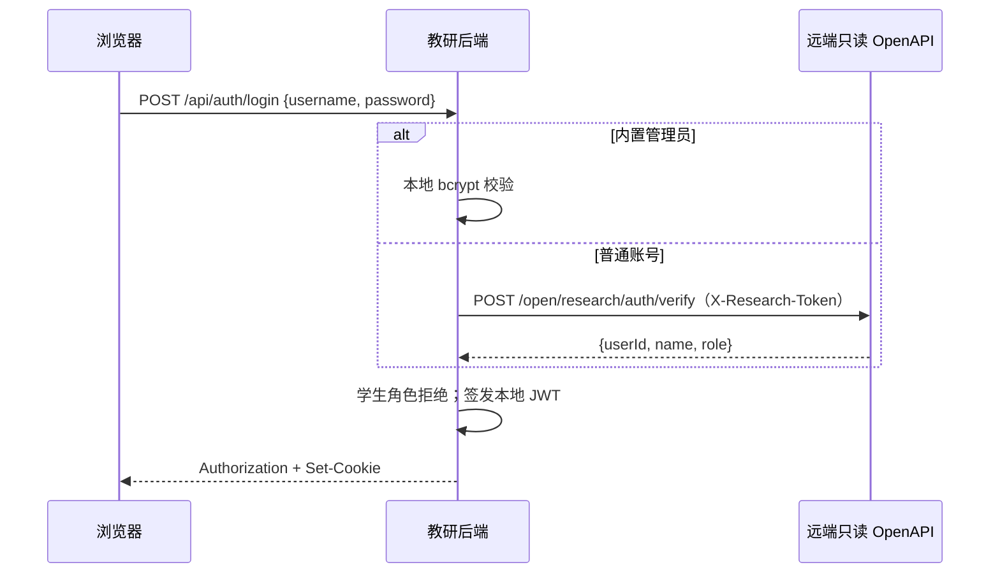

# 教研平台（独立系统）技术设计

Feature Name: teaching-research-platform-v2
Updated: 2026-11-23

## Description

在仓库根新增 `research-platform/`，包含独立后端与独立前端，使用独立数据库 `wisestar_research`（MySQL 8；预览环境 H2）。平台承接 6 个业务模块，账号体系复用现有用户主表：登录时由教研后端调用 AI 自习室新增的只读 OpenAPI 校验凭据并取回角色，随后在教研平台本地签发 JWT。所有教研业务数据落教研库；远端知识点与题目只保存引用 ID 与选题快照。

设计目标：代码解耦、库表隔离、单向只读、可阶段交付、轻量部署。与现有系统共享的只有「HTTP 只读接口 + 账号密码校验结果」，不共享表、不共享进程、不共享构建产物。

## Architecture

### 系统拓扑



### 关键边界

1. 教研后端不引入 AI 自习室任何模块依赖，远端交互全部走 HTTP。
2. 远端 OpenAPI 只有查询与凭据校验，无写方法；教研库与远端库之间无数据源复用。
3. 前端只访问教研后端；远端资源由教研后端代理返回，避免浏览器跨域与令牌外泄。

### 目录结构

```
research-platform/
├── server/                     # Spring Boot 单模块，包名 cn.wisestar.research
│   ├── pom.xml
│   ├── start-preview.sh        # H2 + 7010 端口
│   └── src/main/
│       ├── java/cn/wisestar/research/
│       │   ├── ResearchApplication.java
│       │   ├── api/            # Controller：plan/lesson/card/exam/paper/resource/export/auth
│       │   ├── service/        # ServiceImpl 承载业务
│       │   ├── domain/         # model / mapper / dto / view
│       │   ├── remote/         # 远端 OpenAPI 客户端（RestTemplate + 令牌 + 短缓存）
│       │   ├── security/       # JWT、角色、数据权限拦截器
│       │   └── support/        # 统一响应、异常、分页、审计填充、导出渲染
│       └── resources/
│           ├── application.yml
│           ├── application-preview.yml
│           ├── scripts/{init-h2.sql,init-mysql.sql}
│           ├── export/{teacher.html,parent.html}
│           └── fonts/          # 导出用中文字体子集
└── client/                     # React 19 + antd 6 + Vite
    ├── vite.config.js          # server.allowedHosts + /api 代理 + manualChunks
    └── src/{api,pages,components,styles,stores}
```

### 现有仓库内需要新增的远端只读接口

| 方法 | 路径 | 用途 |
| --- | --- | --- |
| POST | `/open/research/auth/verify` | 校验用户名密码，返回用户标识、显示名、角色 |
| GET | `/open/research/subjects` | 学科列表 |
| GET | `/open/research/chapters?subjectId&grade&term` | 章节树 |
| GET | `/open/research/sections?chapterId` | 小节列表 |
| GET | `/open/research/knowledge-points?sectionId` | 知识点列表 |
| GET | `/open/research/questions?knowledgePointIds&type&difficulty&keyword&current&pageSize` | 题目分页检索 |
| GET | `/open/research/questions/{id}` | 题目详情（含答案与解析） |

实现要点：

- 新增 `OpenResearchApi`（`server/api`）与 `OpenResearchService` 接口（`shared`）/ 实现（`rdbms`），复用现有知识树与题库查询逻辑，不新增表。
- 安全配置放行 `/open/research/**`，改用请求头 `X-Research-Token` 与服务端配置 `research.open.token` 比对；令牌从环境变量 `RESEARCH_OPEN_TOKEN` 注入。
- 响应不含内部表名与自增规则；题目详情仅返回教学内容字段。

## Components and Interfaces

### 前端页面结构

| 路由 | 页面 | 说明 |
| --- | --- | --- |
| `/login` | 登录页 | 账号密码 + 远端校验失败提示 |
| `/plans` | 班课方案列表 | 筛选、状态标签、审核入口 |
| `/plans/:id` | 方案详情/编辑 | 核心字段、远端知识点绑定、提交审核 |
| `/lessons?planId=` | 课次列表 | 拖拽排序、序号修改、批量提交 |
| `/lessons/:id` | 课次备课 | 课次信息 + 卡片折叠流 + 进度条 + 跳转组卷 |
| `/exams` | 真题试卷列表 | 上传原卷、状态、审核 |
| `/exams/:id` | 逐题录入 | 题目行内编辑、重点题标记、知识点绑定 |
| `/analysis` | 考点分析 | 高频知识点、题型统计、重点题汇总、匹配课次 |
| `/papers/new` | 组卷工作台 | 双选题模式、拖拽排序、双视图、保存模板 |
| `/papers/templates` | 我的模板 | 检索、复用 |
| `/resources` | 资源导航 | 分类筛选、外链新窗口、免责提示 |
| `/export` | 批量导出 | 选方案+课次，教师版/家长版 |

统一使用 `api/request.js`（拦截器解包统一响应）、`components/` 通用分页表格、状态标签、上传、确认弹窗。

### 后端分层

- `api`：参数校验、鉴权注解、DTO 转换编排，不写业务。
- `service`：状态机、唯一性校验、数据权限、快照、渲染。
- `remote`：`RemoteResearchClient` 统一超时（连接 1s / 读取 3s）、单次重试关闭、失败抛出 `RemoteUnavailableException`。
- `security`：`@PreAuthorize` 功能权限 + `ResearchScopeInterceptor` 注入当前用户与角色，Service 层统一追加 `create_by` 条件。

### 登录时序



角色映射：远端返回 `teacher/supervisor/admin`，学生与其他角色在教研平台侧拒绝。

## Data Models

所有表继承审计列 `id / create_at / create_by / update_at / update_by / is_deleted`；ID 采用与现有系统一致的雪花字符串。

### t_research_admin（兜底管理员）

| 列 | 类型 | 说明 |
| --- | --- | --- |
| username | varchar(64) | 唯一 |
| password | varchar(100) | BCrypt |
| display_name | varchar(64) | 显示名 |

### t_research_plan（班课方案）

| 列 | 类型 | 说明 |
| --- | --- | --- |
| semester / subject / grade / class_type | varchar | 维度，班型为基础/提高/冲刺/自定义 |
| name | varchar(120) | 方案名称 |
| audience | text | 适配人群 |
| core_modules / training_tasks / acceptance | text | 核心知识模块、硬性训练、达标标准 |
| resource_source | varchar(255) | 加盟品牌/借用/备注 |
| remote_bind | text(JSON) | 远端知识点引用 ID 列表 |
| status | varchar(16) | DRAFT/PENDING/PUBLISHED/ARCHIVED |
| published_key | varchar(8) | 已发布时置 `1`，否则 NULL |
| reject_reason | varchar(500) | 驳回原因 |

唯一约束：`uk_plan_published(semester, subject, grade, class_type, published_key)`，利用 MySQL 多 NULL 特性保证同维度仅一份已发布。

### t_research_lesson（课次）

| 列 | 类型 | 说明 |
| --- | --- | --- |
| plan_id | varchar | 所属已发布方案 |
| seq | int | 1–20，方案内唯一 |
| title / total_goal | varchar/text | 标题、总目标 |
| subject_ref | varchar(255) | 语文课本篇目 / 数学教材章节 |
| board_outline | text | 板书提纲 |
| attachments | text(JSON) | 课程附件引用 |
| homework | text(JSON) | 可选整课作业 |
| status | varchar(16) | DRAFT/PENDING/FINAL |

唯一约束：`uk_lesson_seq(plan_id, seq, is_deleted)`；删除逻辑删除后允许复用序号。

### t_research_lesson_card（知识点卡片）

| 列 | 类型 | 说明 |
| --- | --- | --- |
| lesson_id | varchar | 所属课次 |
| sort | int | 拖拽顺序 |
| name / minutes | varchar/int | 卡片名、预计时长 |
| pre_assess / objectives / question_types | text | 学情预判、学习目标、题型清单 |
| strategies | text(JSON) | 授课方式多选 + 步骤拆解 |
| examples / exercises / card_homework | text(JSON) | 例题、随堂练习、课后作业（含来源标记与快照） |
| completed | tinyint | 必填项齐备自动置 1 |

### t_research_self_question（教研自建题）

| 列 | 类型 | 说明 |
| --- | --- | --- |
| subject / grade | varchar | 所属 |
| kp_refs | text(JSON) | 远端/自研知识点引用 |
| type / difficulty | varchar | 题型、难度 |
| stem / options / answer / analysis | text | 题干、选项、答案、解析 |
| score | decimal(5,1) | 默认分值 |

### t_research_exam_paper（真题试卷）

| 列 | 类型 | 说明 |
| --- | --- | --- |
| name / district / school | varchar | 试卷名、地区、学校 |
| semester / grade / subject / exam_type | varchar | 期中/期末 |
| total_score | decimal(6,1) | 总分 |
| pdf_url | varchar(255) | 原卷 PDF（教研库文件） |
| status | varchar(16) | DRAFT/PENDING/ARCHIVED |
| plan_id | varchar | 可选关联班课方案 |
| reject_reason | varchar(500) | 驳回原因 |

### t_research_exam_question（真题题目）

| 列 | 类型 | 说明 |
| --- | --- | --- |
| paper_id / no | varchar | 所属试卷、题号 |
| type / score / difficulty | varchar/decimal | 题型、分值、难度 |
| stem / answer / analysis | text | 题干、答案、解析 |
| kp_refs | text(JSON) | 知识点引用 |
| is_key | tinyint | 重点题标记 |

### t_research_paper（组卷试卷）与 t_research_paper_question

`t_research_paper`：名称、年级、学科、plan_id、满分、时长、命题人、备注、is_template、template_name、view_type。
`t_research_paper_question`：paper_id、sort、source_type(`REMOTE/SELF/EXAM/TEMP`)、source_id、score、question_snapshot(JSON)。

> 组卷时把题目内容序列化为 `question_snapshot`，后续源题修改不影响历史试卷；这是「仅当前试卷生效」的落点。

### t_research_kp（教研自研知识点）

父级 `parent_id`、`subject/grade/term`、`name`、`path`；与远端知识点并存，用来源字段区分。

### t_research_resource（资源导航）

名称、url、学科、年级、分类、简介、kp_refs、录入人。

### t_research_export_record（导出记录）

导出类型（单课/批量）、文档类型（教师版/家长版）、lesson_ids、文件路径、创建人。

### t_research_flow_log（状态流转日志）

biz_type(`PLAN/LESSON/EXAM`)、biz_id、from_status、to_status、action、remark、operator。

## Interfaces

### 教研后端 REST（前缀 `/api`）

| 模块 | 接口 |
| --- | --- |
| 鉴权 | `POST /auth/login`、`POST /auth/logout`、`GET /auth/me` |
| 方案 | `GET/POST /plans`、`GET/PUT/DELETE /plans/{id}`、`POST /plans/{id}/submit`、`POST /plans/{id}/review`、`POST /plans/{id}/archive` |
| 课次 | `GET/POST /lessons`、`GET/PUT/DELETE /lessons/{id}`、`POST /lessons/reorder`、`POST /lessons/{id}/submit`、`POST /lessons/{id}/review` |
| 卡片 | `GET/POST /lessons/{id}/cards`、`PUT/DELETE /cards/{id}`、`POST /cards/reorder` |
| 题目 | `GET /questions/remote`、`GET/POST /questions/self`、`PUT /questions/self/{id}` |
| 真题 | `GET/POST /exams`、`GET/PUT /exams/{id}`、`POST /exams/{id}/items`、`POST /exams/{id}/submit`、`POST /exams/{id}/review`、`POST /exams/{id}/bind-plan` |
| 分析 | `GET /analysis/knowledge`、`GET /analysis/types`、`GET /analysis/key-questions`、`GET /analysis/lesson-matches` |
| 组卷 | `GET/POST /papers`、`GET/PUT/DELETE /papers/{id}`、`POST /papers/{id}/items`、`GET /papers/{id}/preview?view=student|teacher`、`GET /papers/{id}/pdf`、`POST /papers/{id}/save-template` |
| 资源 | `GET/POST /resources`、`PUT/DELETE /resources/{id}` |
| 导出 | `POST /exports/teacher`、`POST /exports/parent`、`GET /exports/{id}/file`、`GET /exports` |

统一响应 `{code, data, message}`，分页 `{total, list, current, pageSize}`。

### 远端契约（教研后端视角）

- 请求头：`X-Research-Token: ${RESEARCH_OPEN_TOKEN}`。
- 分页：`current/pageSize`，最大 100。
- 失败：HTTP 4xx/5xx + `{code, message}`；教研后端统一转成 `RemoteUnavailableException` 并降级。
- 缓存：`Caffeine` 本地缓存，学科/章节/知识点 10 分钟，题目检索 1 分钟，可在 `application.yml` 配置。

## Correctness Properties

1. **单向只读**：教研后端代码中不存在对远端系统的 POST/PUT/DELETE（除凭据校验 POST），远端 OpenAPI 无写方法。
2. **维度唯一**：同 `semester+subject+grade+class_type` 至多一条 `status=PUBLISHED` 或 `published_key='1'` 的方案。
3. **删除保护**：`t_research_lesson` 存在时，对应方案只能归档，不能逻辑删除。
4. **课次上限**：任一方案 `count(lesson where plan_id=X and is_deleted=0) <= 20`，且在事务内校验。
5. **序号唯一**：同方案内有效课次 `seq` 唯一；拖拽后整体重排在同一事务完成。
6. **状态机合法**：只允许设计定义的状态迁移，非法迁移返回错误并写流转日志。
7. **快照隔离**：试卷与卡片中的题目内容来自 `question_snapshot`，源题后续变化不影响已保存内容。
8. **家长版零题目**：家长版渲染上下文中不注入 `examples/exercises/homework` 与答案/解析字段，模板亦不引用这些键。
9. **文档无页眉水印**：导出模板无 header/footer/logo/watermark 节点。
10. **审计完整**：所有写操作产生 `update_at/update_by`；状态操作产生流转日志。

## Error Handling

| 场景 | 处理 |
| --- | --- |
| 远端超时 / 5xx | 3 秒内失败，返回 `50301 远端资源暂不可用`，页面局部降级，不阻塞本地保存 |
| 登录凭据错误 | 统一提示「用户名或密码错误」，不区分远端与本地 |
| 学生角色登录 | 拒绝并提示「教研平台仅对教师开放」 |
| 方案维度冲突 | 返回 `40901` 与占用维度说明 |
| 课次超过 20 节 | 返回 `40902 最多 20 节课次` |
| 非法状态迁移 | 返回 `40903`，附当前状态与允许动作 |
| 删除被引用方案 | 返回 `40904 方案已被课次引用，只能归档` |
| 文件类型/大小非法 | 原卷仅 PDF，≤20MB；附件白名单校验 |
| 导出失败 | 记录失败原因，导出记录置失败态，可重试 |
| 未登录/越权 | `401/403` 统一响应，前端跳登录或提示无权限 |

## Test Strategy

### 后端

- 单元测试（JUnit 5 + Mockito）：唯一性校验、状态机、课次上限、序号重排、快照生成、家长版上下文裁剪。
- 集成测试（MockMvc + H2）：登录（本地管理员 / 远端 Mock）、方案审核流、课次与卡片 CRUD、真题审核、组卷总分计算。
- 远端客户端测试：使用 WireMock 模拟超时、4xx、5xx，断言降级行为与缓存命中。
- 导出测试：渲染教师版/家长版 HTML，断言家长版不含题目文本、答案与解析；PDF 生成成功且页数 > 0。

### 前端

- `npm run lint` 0 error、`npm run build` 通过。
- 关键交互手工冒烟：方案提交/审核、卡片必填项进度、拖拽排序、远端选题弹窗、真题逐题录入、组卷双视图、导出预览。
- 预览环境 1366×768 实拍主要页面，确认一屏可用与无横向溢出。

### 现有仓库回归

- 新增 `/open/research/**` 后，验证现有登录、管理端知识树、学员端学习链路不受影响；`mvn clean package -pl api -am -DskipTests` 通过。
- 安全用例：无令牌访问 `/open/research/**` 返回 401；令牌错误返回 401；只读接口无写方法。

## 交付阶段映射

| 阶段 | 范围 | 验收 |
| --- | --- | --- |
| 一 | 工程骨架、独立库、登录与角色、班课方案与审核 | 可登录、可建/审/发布方案 |
| 二 | 课次、知识点卡片、完成度、双来源选题、跳转组卷 | 备课体系可完整使用 |
| 三 | 真题入库与审核、考点分析、匹配课次、组卷/打印/模板 | 可分析与出卷打印 |
| 四 | 资源导航、教师版/家长版导出与批量导出 | 可导出两类文档 |

## 开发与运维约束（用户定稿，优先级最高）

以下五条是甲方明确的目标，任何实现方案冲突时以本节为准。

### 1. 故障隔离：一套系统挂掉不影响另一套

- 进程、端口、数据库、静态资源、日志目录、备份全部独立；不共享 JVM、不共享 Maven 模块、不共享构建产物。
- 远端只读 OpenAPI 是唯一运行时依赖：连接超时 1 秒、读取超时 3 秒、不重试；失败时教研平台降级为「本地数据可读写 + 远端资源暂不可用」，登录走内置管理员兜底。
- 同机部署时给两边分别设内存与 CPU 上限（JVM `-Xmx` 或 cgroup），任一方 OOM 不拖垮另一方。
- 各自提供 `/api/health`，部署脚本按健康检查判断启动完成；升级、重启、回滚互不通知。

### 2. 跨系统数据：只走接口，不碰对方的库

- 硬约束：不跨库查询、不跨库 JOIN、不直连对方数据库、不反向写入。这条在 code review 与测试用例中都要验证。
- 远端知识点、题目只保存两种东西：**引用 ID**（用于跳转与检索）与**展示快照**（名称、题干、答案等，用于列表与文档渲染）。远端后续改名或改题，历史备课与历史试卷保持原样。
- 账号共用但不复制：教研平台不建用户主表，只在本地保存「远端用户标识 → 角色」的映射与登录审计；远端不可用时仅内置管理员可登录。
- 接口契约版本化：路径固定 `/open/research/v1/**`，只增字段不删字段；契约文件入库，两边按同一份契约开发与联调。
- 同机时也走 `http://127.0.0.1:1991`，不走数据库直连；服务令牌走环境变量，不入库、不入代码、不写日志。

### 3. 可交接：换一个对话/换一个人能接着开发

- 两侧各有一份 `AGENTS.md`：根 `AGENTS.md` 增加教研平台入口（端口、构建、启动、库位置），`research-platform/AGENTS.md` 记录本系统约定、目录职责与常见坑。
- 规格先行：需求与设计固定在 `.monkeycode/specs/2026-11-23-teaching-research-platform-v2/`，每次结构变更同步更新，避免只存在对话里。
- 契约文件：`research-platform/contract/open-research-v1.yaml` 作为远端接口唯一真源；AI 侧实现与教研侧客户端都以它为准，联调先跑契约用例。
- 一键起步：`research-platform/server/start-preview.sh`（H2）+ `client/npm run dev`；构建命令写进两侧 AGENTS，新对话照抄即可跑起来。
- 数据可复现：`init-h2.sql` / `init-mysql.sql` 幂等，演示数据由 Seeder 生成；预览库支持快照导出/恢复，禁止手工改库。

### 4. 云端部署：单域名路径反代，互不打扰

定稿为单域名路径反代，一套证书、一个入口：

```nginx
server {
    listen 443 ssl;
    server_name example.com;

    # 教研后端：必须放在 /research/ 之前，避免被 SPA 兜底吞掉
    location /research/api/ {
        proxy_pass http://127.0.0.1:7010/api/;
        proxy_set_header Host $host;
        proxy_set_header X-Real-IP $remote_addr;
    }

    # 教研前端：Vite base=/research/，React Router basename=/research
    location /research/ {
        alias /srv/research/client/dist/;
        try_files $uri $uri/ /research/index.html;
    }

    # AI 自习室保持原状
    location /api/ { proxy_pass http://127.0.0.1:1991/api/; }
    location / { root /srv/wisestar/client/dist; try_files $uri /index.html; }
}
```

- 路径约定：`VITE_BASE_PATH=/research/`、Router `basename=/research`、生产 API 基址 `/research/api`、开发代理 `/api → http://127.0.0.1:7010`；三处由同一环境变量推导，避免部署后白屏或接口 404。
- 教研会话 Cookie 名 `research-token`，`Path=/research`，`SameSite=Lax`；与 AI 自习室的 `sk-token` 同域共存、互不覆盖。
- 全部配置走环境变量：`DB_URL/DB_USER/DB_PASSWORD`、`OPEN_RESEARCH_BASE_URL`、`RESEARCH_OPEN_TOKEN`、`SERVER_PORT`、`DATA_DIR`、`VITE_BASE_PATH`。
- 附件与导出文件落在 `research-platform/server/data`，作为持久化目录单独挂载与备份；不写进 AI 自习室目录。
- 备份分离：两个库各自 `mysqldump`，教研库备份不依赖 AI 库，恢复顺序互不影响。
- 部署脚本 `research-platform/deploy.sh` 负责：构建前端、拷贝 dist、重启本系统服务、调用 `/api/health` 自检；AI 自习室的重启发由独立脚本负责。
- 端口只暴露 443：1991/7010 绑定回环或由安全组/防火墙拦截，`/open/research/**` 未经 nginx 转发，也不得直接对公网开放。

### 5. 低维护：少组件、少表、少流程

- 不引入新中间件：缓存用进程内 Caffeine，不上 Redis / MQ / ES；PDF 用服务端模板，不额外起浏览器服务。
- 表数量控制在 12 张左右，公共审计列、统一响应、统一分页、统一异常沿用现有规范，不另造一套。
- 审核流程只有方案、课次、真题三处；组卷、资源导航、导出不设审核。
- 权限只做「老师看自己、主管看全部」两级数据范围，不做复杂 RBAC 配置界面。
- 前端复用 antd 表格/表单/弹窗，不引入重型图表库；考点分析用可排序表格即可满足。

## Risks and Decisions

1. **PDF 中文字体**：选用 `openhtmltopdf + Thymeleaf`，随包内置中文字体子集；若字体授权或体积不可接受，备选方案为调用无头 Chromium 打印。该风险在阶段四前验证。
2. **远端接口改造范围**：现有仓库需新增只读接口与安全放行，属于跨系统契约变更，需与现有安全配置一起回归。
3. **同维度唯一索引**：MySQL 与 H2 对多 NULL 唯一索引行为一致，H2 预览环境需实际建表验证。
4. **不新建用户表**：远端不可用时仅内置管理员可登录，这是文档明确定稿的兜底策略。
5. **组卷题目快照体积**：题目快照以 JSON 存储，单卷 ≤100 题，预估单卷 <2MB，可接受。

## References

[^1]: (文档) - 《教研平台产品需求规格与开发排期》原始 15 页 Word（2026-11-23 会话解析）
[^2]: (仓库) - `AGENTS.md` 构建、数据库与代码约定
[^3]: (历史规格) - `.monkeycode/specs/2026-09-08-teaching-research-platform/`（管理端页内教研工作台，与本平台不同）
